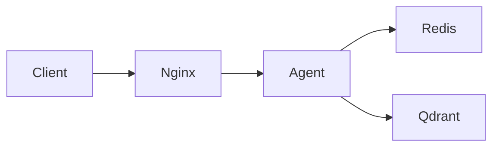

# Day 14 — Mission Answers

Trạng thái: đã hoàn thành Part 1–7 và deploy Render (https://day14-production-agent.onrender.com); mọi số liệu lấy từ lần chạy thật, phần nào chưa kiểm chứng được ghi rõ. Code Part 6 nằm trong `06-lab-complete/` theo quy định K5.

## Part 1 — Localhost vs Production

### Exercise 1.1 — Anti-patterns

Trong `01-localhost-vs-production/develop/app.py`: (1) `OPENAI_API_KEY` hardcode; (2) `DATABASE_URL` chứa thông tin đăng nhập; (3) `DEBUG = True` cố định; (4) `print` cả API key; (5) không có `/health`; (6) bind `localhost` khiến bên ngoài container không truy cập được; (7) port 8000 cố định; (8) bật `reload=True` khi chạy; (9) chưa có xác thực, rate limit hoặc budget guard.

### Exercise 1.2 — Chạy develop

Lệnh đúng của bản develop là `POST /ask?question=Hello`. JSON body không cung cấp query parameter nên trả 422. Kết quả thực nghiệm được bổ sung ở mục bằng chứng sau khi chạy.

### Exercise 1.3 — So sánh

| Tính năng | Develop | Production mẫu | Ý nghĩa |
|---|---|---|---|
| Config | Hằng số trong code | `config.py`, env | Cùng image dùng cho nhiều môi trường |
| Bind/port | localhost:8000 | host/port từ settings | Cho container và cloud nhận traffic |
| Logging | print, lộ key | logging có field | Tra cứu sự cố, tránh lộ credential |
| Liveness | Không có | `/health` | Phát hiện process chết |
| Readiness | Không có | `/ready`, lifecycle flag | Chỉ đưa request tới instance sẵn sàng |
| Lifecycle | Reload dev | lifespan startup/shutdown | Giải phóng tài nguyên khi dừng |

Đây là so sánh code mẫu, không khẳng định mọi chi tiết mẫu đều production-safe: formatter dùng nội suy chuỗi có thể tạo JSON sai khi message chứa dấu nháy. Part 6 dùng `json.dumps` để encode JSON đúng.

## Part 2 — Docker

### Exercise 2.1

1. Base image develop: `python:3.11`.
2. `WORKDIR /app` đặt thư mục hiện hành cho các lệnh tiếp theo.
3. Copy requirements và cài dependency trước source để đổi source không làm mất cache layer dependency.
4. `CMD` khai báo command/arguments mặc định, có thể thay bằng arguments của `docker run`. `ENTRYPOINT` định nghĩa executable chính; khi dùng cùng CMD, CMD cung cấp arguments mặc định. Exec form giúp quản lý signal rõ ràng.

### Exercise 2.2-2.3

Multi-stage keeps dependencies in a slim runtime and excludes build tools/cache. Measured with `docker image inspect` after building from repository root:

| Image | Bytes | Decimal MB |
|---|---:|---:|
| develop | 1667787933 | 1667.79 |
| production | 239811723 | 239.81 |

Reduction: **85.62%**, calculated as `(develop_bytes - production_bytes) / develop_bytes * 100`. Both containers returned200 for `/health`; develop query `POST /ask?question=Hello` and production JSON `POST /ask` returned200. Evidence: `reports/docker_examples_runtime.json`. Production needed `PYTHONUSERBASE` to resolve packages for its non-root user.

### Exercise 2.4



Stack topology: Nginx -> agent -> Redis and Qdrant on the Compose network. Agent depends on Redis/Qdrant healthchecks; service DNS connects containers rather than localhost.

Full stack executed with `docker compose -p k5-day14-docker up -d --build`. Redis and Qdrant became healthy; `/health`, `/ready` and JSON `POST /ask` through Nginx on port80 all returned200. Redis CLI returned PONG. Evidence: `reports/docker_fullstack_runtime.json`; direct container/image comparison: `reports/docker_examples_runtime.json`. Used cached `nginx:1.28-alpine` locally tagged `nginx:alpine` because the original alpine-tag pull stalled. Qdrant image `qdrant/qdrant:v1.9.0` was pulled successfully. Created empty ignored `.env.local` per README. Stack and task-specific volumes were removed afterward with `docker compose -p k5-day14-docker down -v`.

## Part 3 — Cloud Deployment

Nền tảng chính: **Render**, deploy agent Part 6 cùng Redis (Key Value) bằng Blueprint `06-lab-complete/render.yaml`. URL public: **https://day14-production-agent.onrender.com**. `/health` 200, `/ready` 200, `/ask` không key 401; checker gốc với `--public-url` báo PASS 12/12 (44/44), bằng chứng `reports/production_public_url.txt`. Chi tiết, biến môi trường và ảnh: `DEPLOYMENT.md`.

Railway dùng TOML, khai báo builder Dockerfile và healthcheckPath; Redis là service riêng, nối bằng biến môi trường reference. Render dùng YAML Blueprint, có thể mô tả web service cùng managed key-value và tham chiếu connection string. Cả hai phải dùng `/health`, bind `0.0.0.0`, đọc PORT và cấp secret ngoài source. Có config chưa có nghĩa đã deploy thành công.

### Exercise 3.3 — Cloud Run

`cloudbuild.yaml` cài dependency rồi chạy pytest, sau đó build image gắn COMMIT_SHA và latest.
Image được push lên Container Registry, bước deploy chờ push thành công rồi chạy `gcloud run deploy` tại asia-southeast1.
Pipeline cấu hình CPU/memory, min/max instances, timeout và secret từ Secret Manager.
`service.yaml` mô tả service tương tự dưới dạng khai báo, concurrency 80, probe `/health` và `/ready`.
Đây là đọc cấu hình mẫu; chưa thực thi pipeline. Bước test mẫu cần fail-fast để lệnh echo sau pytest không che exit code lỗi.

## Part 4 — API Security

### Exercise 4.1–4.3

API key được kiểm tra trong dependency trước endpoint; thiếu/sai trả 401. Rotate key bằng cách thay secret môi trường rồi rollout instance; thu hồi key cũ, không ghi key vào log/commit.

Bản JWT mẫu lấy token ở `POST /auth/token` bằng tài khoản demo trong hướng dẫn. Student được 10 request/phút; admin dùng limiter khác (100 request/phút), không phải miễn giới hạn. Sliding window loại timestamp cũ hơn 60 giây rồi đếm request trong cửa sổ hiện tại. Bản mẫu lưu RAM nên không chia sẻ giữa worker; Part 6 dùng Redis để state còn sau restart.

Output HTTP thực tế (`scripts/verify_examples.py`, bằng chứng `reports/examples_runtime.json`): thiếu xác thực 401; lấy token 200; 10 request hợp lệ liên tiếp trả 200; request thứ 11 trả 429. Token không lưu trong report. Đây là HTTP test tự động tương đương thao tác curl, chưa có ảnh/output `curl -i` theo checklist.

### Exercise 4.4

Rate limit bảo vệ tốc độ gọi; cost guard bảo vệ tổng chi phí. Trước khi gọi LLM, kiểm tra chi phí tích lũy theo ngày; hết budget trả 402. Sau thành công, tính `input_tokens/1000 * input_price + output_tokens/1000 * output_price`, cộng vào Redis. Bộ đếm dùng key theo ngày và expiration; không lưu dict riêng ở từng worker. Kiểm tra rồi ghi sau có thể vượt budget bởi các request đồng thời; ngân sách cứng cần cơ chế reservation/settlement nguyên tử.

## Part 5 — Scaling & Reliability

`/health` là liveness: process sống vẫn trả 200 kể cả khi Redis chết. `/ready` kiểm tra dependency: Redis không truy cập được trả 503 để load balancer ngừng chuyển traffic. Khởi động lại process không chữa được Redis outage nên không gộp hai probe này.

Uvicorn nhận SIGTERM, ngừng nhận request mới, chờ request đang chạy xong rồi thực hiện lifespan cleanup. Không thay handler bằng một hàm chỉ log và bỏ signal. Việc này cần kiểm tra thực trên Linux/WSL theo README.

State trong RAM chỉ có ở một process: request tới instance khác hoặc restart sẽ mất session/rate limit. Redis ngoài process cho phép worker dùng chung state. Nginx phân phối traffic qua các instance; service discovery và health/readiness quyết định đích có thể nhận request.

Actual Exercise5.4-5.5: `docker compose -p k5-day14-scaling up -d --build --scale agent=3`, then unchanged `python test_stateless.py` exited0. Five requests rotated across instance-f553b2, instance-70749d and instance-1c7f22; shared Redis history retained10 messages (5 user +5 assistant). Evidence: `reports/scaling_runtime.txt`. Cached Nginx1.28-alpine was locally tagged nginx:alpine because the original pull stalled. Stack was taken down after testing, releasing8080. This script verifies shared history; it does not kill an instance or prove in-flight shutdown.

## Part 6 — Kết quả checker

Checker nguyên bản chạy đầy đủ trong Python 3.11 Linux container, Redis thật, Docker daemon thật: **PASS 12/12, 43/43 checks passed**. Bằng chứng: `reports/production_linux.txt`. Chạy lại trên Windows bằng `tools/production-check/run.ps1` (Docker Desktop Linux đang bật, truyền đường dẫn docker nếu chưa có PATH).

```text
📋 Checklist Deliverable
✅ Dockerfile (multi-stage, < 500 MB)
✅ docker-compose.yml (agent + redis)
✅ .dockerignore
✅ Health check endpoint (GET /health)
✅ Readiness endpoint (GET /ready)
✅ API Key authentication
✅ Rate limiting
✅ Cost guard
✅ Config từ environment variables
✅ Structured logging
✅ Graceful shutdown
✅ Public URL ready (Railway / Render config)
Result: 12/12 tiêu chí đạt · 43/43 checks passed
🎉 PASS 12/12 — PRODUCTION READY! Deploy nào!
```

Chạy lại checker đầy đủ kèm `--public-url https://day14-production-agent.onrender.com`: PASS 12/12, **44/44** checks, có thêm `Public URL: GET /health → 200` (`reports/production_public_url.txt`). Kiểm tra image độc lập: 286286447 byte, user UID 10001, health 200/readiness 503 khi Redis không sẵn sàng, stop exit 0; xem `reports/packaging_runtime.txt`. Hai file `production_static.txt`/`production_runtime.txt` là lần kiểm tra trung gian trước khi Docker/Redis sẵn sàng, không phải kết quả cuối.

## Bằng chứng chạy ví dụ

Chạy `.venv-benchmark/Scripts/python.exe scripts/verify_examples.py` trên Windows. Part 1: query POST trả 200 và có answer; JSON-only trả 422. Part 4: 401/200/429 đúng như trên. Script khởi động server riêng, gửi HTTP thật, tắt server sau kiểm tra; không chứng minh graceful SIGTERM Linux. Đặt PYTHONIOENCODING=utf-8 vì ví dụ develop in tiếng Việt ra stdout.

## AI log (chi tiết)

| Yêu cầu giao AI | Kết quả nhận được | Kiểm tra do AI thực thi |
|---|---|---|
| Hoàn thiện các TODO Part 6 theo hợp đồng K5 | Config env, auth, Redis atomic rate limit, cost guard, health/readiness, JSON log | `ca2547f`; checker Linux nguyên bản PASS12/12 ở `c4da508` |
| Đóng gói Docker và chuẩn bị cloud config | Multi-stage non-root, Compose Redis, Railway/Render | `018add7`, build/runtime `ed7c3fc`; deploy Render `e773daf` |
| Trả lời Part 1–5 bằng code và bằng chứng thật | Mission answers, HTTP401/200/429, image size, Redis history qua3instance | `2132484`, `d551852`, `e41b976`; học viên chưa tự xác nhận |
| Đo chất lượng/hiệu năng và sửa retrieval thiếu tài liệu | Baseline, histogram, KB JWT/HPA, fixed23/23, CI, load CSV/JSON | Các JSON/CSV đi kèm BENCHMARK_REPORT; không sửa golden dataset |

AI đã tự phát hiện và sửa `PYTHONUSERBASE` cho các Dockerfile ví dụ dùng non-root; đã chạy lại image/stack thực. Rà soát cuối không phát hiện lỗi chặn theo rubric; checker/dataset không đổi, không track `.env` thật. Học viên tự đăng nhập Render và tạo Blueprint; Claude Code kiểm tra URL public, chạy checker với `--public-url` và chụp `running.png`. 4 ảnh Part 7 (Grafana, 2 trace Jaeger, Prometheus alerts) do Claude Code chụp bằng Chrome headless từ stack chạy thật trên máy học viên, trong một lần chạy bổ sung có chaos riêng (`reports/chaos_screenshot_alerts.json`).

- Yêu cầu: đọc hướng dẫn, chia giai đoạn, giao task cho agent, commit ngay sau mỗi task hoàn thành.
- AI hỗ trợ: điều phối lập kế hoạch và soạn tài liệu; agent production viết Part 6; agent packaging viết Docker/deploy config; agent benchmark thực thi load/eval, sửa KB và CI.
- Kiểm tra của AI: các lệnh và bằng chứng ghi trong báo cáo/commit; những phần bị môi trường chặn được đánh dấu chưa kiểm chứng.
- Phần học viên tự sửa/tự chạy/tự giải thích: **chưa được học viên xác nhận**. Cần đọc code và chạy lại các kiểm tra trước khi nộp; không coi kiểm tra của AI là kiểm tra cá nhân đã thực hiện.
